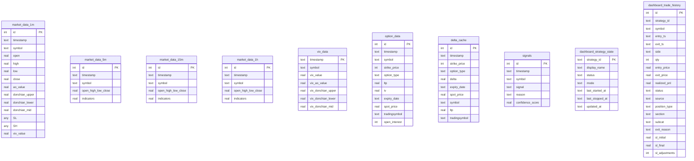
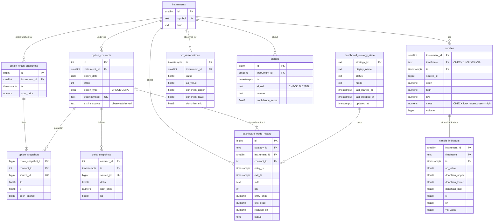

# Normalization: functional dependencies and ER diagrams

Source: `trading_bot.db` (working copy, VACUUMed). Every claim marked *(measured)* was checked
against the real data with a query; the numbers are from the 2026-11-05 run.

## 1. Functional-dependency analysis of the original tables

Notation: `X → Y` means X determines Y. Candidate keys are underlined in words ("key").

### `market_data_1m / 5m / 15m / 1h`
- `id → all columns` (surrogate key).
- `(symbol, timestamp) → all columns`. This is a candidate key, enforced by `ux_market_data_*`.
- **The timeframe lives in the table name, not in a column.** Four relations have identical
  schemas, and the design breaks if a fifth timeframe is added. **Fix:** one `candles`
  relation with `timeframe` as part of the key.
- `donchian_*`, `ao_value` and `SL/SH` don't come from the row itself. They come from a
  *window of earlier rows* (Donchian = rolling max/min, AO = SMA5 − SMA34 of midpoints,
  SL/SH = a path-dependent backfill). These are derived attributes, not FDs inside one row.
  They are stored because the strategy reads the stored values (see §3).
- `SL`, `SH` have **no declared type** in 1m/5m/15m (added by `ALTER TABLE … ADD COLUMN SL`).
  *(measured)* 32,534 rows are REAL; 9 rows are NULL.

### `option_data`
- key: `id`; candidate key `(tradingsymbol, timestamp)`. *(measured)* 0 duplicates.
- `tradingsymbol → (symbol, expiry_date, strike_price, option_type)` and back again.
  *(measured)* 2,103 tradingsymbols ↔ 2,103 contract tuples, 1:1.
  **Transitive dependency** (`id → tradingsymbol → expiry, strike, …`), so this violates 3NF.
  **Fix:** `option_contracts` master table.
- `(symbol, timestamp) → spot_price`. *(measured)* holds in 160/160 snapshots, because the bot
  writes one spot price per option-chain fetch. Through the key this is
  `(contract, ts) → (instrument, ts) → spot_price`, which is transitive and violates 3NF.
  **Fix:** a header/line split. `option_chain_snapshots(instrument, ts, spot)` is the header
  and `option_snapshots` is the line.

### `delta_cache`
- key: `id`. The natural key `(symbol, expiry_date, strike_price, option_type, timestamp)` is
  **not unique**. *(measured)* There are 2,050 duplicate groups.
- Contract attributes depend on `tradingsymbol` (as above). **Fix:** reference `option_contracts`.
- `(symbol, timestamp) → spot_price` **does not hold**. *(measured)* 65 of 13,676 timestamps
  have two different spot prices. So spot is a genuine per-row attribute and stays on
  `delta_snapshots`. No split here.
- **Duplicates:** keep the highest source id per (contract, ts) and quarantine the rest in
  `rejected_rows`. The rule is the same in bulk load and continuous sync. *(measured)*
  346,059 kept, 2,050 quarantined.

### `vix_data`
- key: `timestamp → all`. `symbol` is always `NIFTY50` *(measured)*. It records the underlying
  the VIX was observed for, so it becomes a FK to `instruments`.

### `signals`
- key: `id → all`. `symbol` is repeated text, so it becomes a FK to `instruments`.

### `dashboard_strategy_state`
- key: `strategy_id → all`. Already in 3NF. Timestamps get proper types.

### `dashboard_trade_history`
- key: `id → all`. `symbol` holds an **option tradingsymbol** (e.g. `NIFTY26MAY22400PE`), so
  `symbol → contract attributes` is a transitive dependency.
  **Fix:** `contract_id → option_contracts`, plus `instrument_id`.
- `strategy_id` had no FK. **Fix:** FK to `dashboard_strategy_state`.
- Monthly symbols don't encode the expiry day. When no observed contract matches, the expiry is
  derived (last Tuesday of the month, or last Thursday before Sep-2025) and the contract is
  flagged `expiry_source = 'derived'`.

## 2. Before: original SQLite schema (in-scope tables)

There are no foreign keys. Relationships exist only as repeated text.

## 3. After: normalized PostgreSQL schema (migrations 0001–0004)

Pipeline bookkeeping: `schema_version` (migrations), `rejected_rows` (quarantine, unique per
source row). Day 2 adds `sync_state`, `sync_batches` and `schema_fingerprints`.

### Typing decisions ("split typing")
- **NUMERIC(12,2)** for exchange-quoted prices: OHLC, spot, trade prices. *(measured)* Every
  OHLC, spot and trade price round-trips exactly at 2 dp, so nothing is lost.
- **double precision** for computed values: option `ltp` (*(measured)* 126k `option_data` and
  181k `delta_cache` rows aren't exact at 2 dp, e.g. `121.19999999999999`), iv, delta,
  indicators and VIX. These keep the bot's floats bit-for-bit, which level-3 parity needs.
- **timestamptz**: source text is naive Asia/Kolkata wall-clock time. It's loaded with the
  session time zone set to Asia/Kolkata.

### Deliberate, documented denormalizations
- `candle_indicators` stores the bot's indicator values instead of only computing them in
  views. The strategy reads stored `donchian_mid`, and SL/SH are path-dependent, so storing
  them keeps parity exact. (Day 3 adds computed-indicator views plus a drift check.)
- `candle_indicators.vix_value` is the VIX the bot saw when it wrote the candle. `vix_data` is
  irregular point-in-time data, so a join can't reliably recover that value.

## 4. Dead schema: documented, not migrated

| Table | Rows *(measured)* | Why it's left out |
|---|---:|---|
| `trades` | 0 | empty; superseded by `dashboard_trade_history` |
| `options_data` | 0 | empty; superseded by `option_data` |
| `option_open_interest` | 0 | empty; OI pipeline never populated |
| `option_open_interest_5m` | 0 | empty; derived from the table above |
| `market_sma_1m/5m/15m/1h` | 30,294 / 6,536 / 2,329 / 1,235 | written but never read by the strategy; recomputable with window functions |
| `equity_data_*`, `equity_sma_*` | 23,445 … 1,335 | out of scope (equity strategy); INFY is still seeded in `instruments` |

Index redundancy in the source: `idx_market_data_{1m,5m,15m}_symbol_timestamp` duplicate the
unique `ux_…` indexes on the same columns. The Day-4 index audit covers this.
